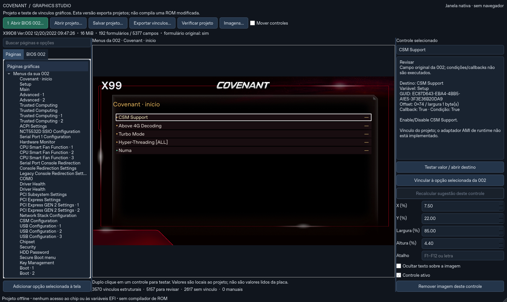

# Manual do Covenant Graphics Studio

**Versão do programa: 0.1.1 · Idioma: português · Revisão: 03/11/2026**

Este manual explica como abrir uma BIOS, organizar sua interface gráfica, associar controles às opções reais e salvar o trabalho. O aplicativo trabalha com arquivos e projetos locais.

**O resultado atual é um projeto de interface, salvo em JSON ou ZIP. O programa ainda não compila uma BIOS gráfica, não grava o chip, não modifica a BIOS aberta e não aplica configurações à placa.**

## 1. Instalar e iniciar no Windows

1. Baixe `Covenant-Graphics-Studio-0.1.1-Windows-x64.zip` no [S21](https://github.com/araujo791/S21/tree/main/covenant-graphics-studio).
2. Clique com o botão direito no ZIP e escolha **Extrair tudo**. Use uma pasta nova, por exemplo `Documentos\Covenant-Graphics-Studio`.
3. Entre na pasta extraída e abra **Covenant-Graphics-Studio.exe**.

O pacote é portátil para Windows 10/11 de 64 bits. Não exige instalação de Python nem execução como administrador. Mantenha o executável, `runtime`, `assets`, `covenant_studio` e `covenant_graphics_studio.py` juntos. Não execute de dentro do ZIP nem copie apenas o `.exe` para outra pasta; use um atalho para ele se preferir.

Não é necessário conectar o CH341 ou executar FPT/flashrom para usar o editor.

## 2. Quais BIOS podem ser abertas

A versão oficial foi preparada para a **Machinist X99D8 Ver:002**, com o layout reconhecido pelo leitor. Aceita:

| Arquivo | Tamanho exato | Conteúdo |
| --- | --- | --- |
| Região BIOS | 8.388.608 bytes, ou 8 MiB | Apenas a região BIOS da 002 |
| Imagem SPI completa | 16.777.216 bytes, ou 16 MiB | Descriptor, SPS e região BIOS no mapa esperado |

Um backup feito por CH341 pode ser usado se a leitura estiver íntegra e corresponder ao perfil suportado. Ter 16 MiB, sozinho, não comprova isso. Nos arquivos completos, o leitor espera a região BIOS entre `0x800000` e `0xFFFFFF`.

Variantes da 002 podem ser aceitas se preservarem as estruturas exigidas. A BIOS 006, a doadora gráfica e BIOS de outras placas não são bases oficialmente suportadas nesta versão. O programa usa os recursos gráficos já incluídos; não há uma segunda caixa para carregar qualquer ROM doadora.

Comentar a checagem do nome `002` no código não acrescenta suporte a outro firmware: também há exigências de volumes, módulos, compressão e variáveis. Essas diferenças precisam ser interpretadas pelo leitor.

## 3. Primeiro uso em poucos passos

1. Clique em **1 Abrir BIOS 002…** e selecione seu `.bin` ou `.rom`.
2. Aguarde a mensagem de leitura terminar. A identificação, o tamanho e as quantidades de formulários e campos aparecem no topo.
3. Na aba **Páginas**, expanda **Menus da sua 002** e selecione uma página.
4. Clique em um controle na prévia central. Confira seu destino no painel direito.
5. Use **Testar valor / abrir destino** ou dê duplo clique no controle.
6. Clique em **Verificar projeto**, depois em **Salvar projeto…**.

Salve com um nome como `meu-projeto-covenant.json`, em uma pasta de trabalho separada dos arquivos do aplicativo. Guarde também uma cópia da BIOS usada para criá-lo: você precisará do mesmo arquivo para reabrir o projeto.

## 4. Conhecendo a janela



| Área | Para que serve |
| --- | --- |
| Barra superior | Abrir BIOS e projetos, salvar, exportar, verificar e acessar imagens |
| Busca à esquerda | Filtrar nomes nas árvores de páginas e opções |
| Aba Páginas | Navegar pelas telas gráficas criadas no projeto |
| Aba BIOS 002 | Consultar os formulários e campos extraídos do arquivo aberto |
| Prévia central | Selecionar, testar e posicionar controles |
| Painel direito | Ver destino, editar texto, posição, atalho e vínculo do controle |
| Contadores inferiores | Ver quantos controles estão vinculados, pendentes ou manuais |

O painel direito pode mostrar variável, GUID, offset, largura do campo, ajuda, callback e presença de condição. **Offset** é a posição dentro da variável indicada, não a posição do campo dentro do arquivo ROM. Não copie um offset de outra placa presumindo equivalência.

## 5. Páginas originais e sugestões da doadora

**Menus da sua 002** usa os formulários e campos da BIOS carregada. O programa já cria controles associados aos campos originais que consegue interpretar. Formulários extensos podem aparecer divididos em páginas com sufixos como `· 1` e `· 2`.

**Sugestões a partir da doadora** contém páginas derivadas dos metadados gráficos incluídos. O programa procura correspondências por módulo, nome do campo, identidade da variável, tipo e opções; usa também o formulário para reduzir ambiguidades. Uma posição numérica igual, isoladamente, não estabelece um vínculo.

Se houver mais de um candidato ou opções incompatíveis, o controle pode permanecer sem vínculo. A sugestão automática precisa ser conferida pelo usuário.

### Cores e estados

| Estado | Cor do ponto | Significado |
| --- | --- | --- |
| Vínculo estrutural | Verde | O destino foi associado pelos dados interpretados |
| Revisar | Amarelo | Existe condição, callback, leitura ou outra pendência indicada no detalhe |
| Sem vínculo | Cinza | Falta correspondência única ou suporte para esse controle |
| Manual | Azul | O destino foi escolhido pelo usuário no projeto |

Nenhum desses estados comprova funcionamento em firmware. Um controle manual também precisa de revisão. Condições e callbacks não são executados pelo editor.

## 6. Associar um controle a uma opção

1. Na aba **Páginas**, abra a tela desejada e clique no controle na prévia.
2. Vá à aba **BIOS 002**. Expanda o formulário e dê **um clique** no campo de destino. Um duplo clique nessa árvore adiciona um novo controle.
3. Clique em **Vincular à opção selecionada da 002** no painel direito.
4. Para listas ou caixas de seleção, confira cada linha de **Conferir opções do vínculo**. Associe cada opção da origem à opção correta do destino e confirme.
5. Verifique o destino e o estado **Manual** no painel direito.

Exemplo: uma origem com `Enabled` e `Disabled` deve ser associada às opções de mesmo significado no destino. Não presuma que o número interno de cada opção seja igual nas duas BIOS.

Campos numéricos exigem tipos compatíveis, largura e sinal correspondentes e intervalo de destino que comporte o intervalo de origem. A validação pode rejeitar uma associação incompatível.

**Recalcular sugestão deste controle** fica disponível para controles de origem doadora. Ele refaz a tentativa automática e pode substituir uma escolha manual daquele controle. Salve antes se quiser preservar uma alternativa.

### Adicionar uma opção à página atual

1. Escolha a página de destino em **Páginas**.
2. Em **BIOS 002**, selecione um campo de valor suportado.
3. Clique em **Adicionar opção selecionada à tela**.
4. Posicione o novo controle na prévia.

Também é possível dar duplo clique no campo da árvore. São aceitos campos numéricos, listas e caixas de seleção com armazenamento válido. Os controles novos começam na mesma região da tela; mova-os para evitar sobreposição.

## 7. Testar valores e navegar

Dê duplo clique no controle ou use **Testar valor / abrir destino**. Se o destino for um formulário, o editor navega para sua página. Se for um campo de valor suportado, abre uma escolha de opções ou uma entrada numérica.

O símbolo **`—`** indica que não há valor de teste definido ou destino de valor disponível. Ele não é uma leitura da configuração atual da placa. O símbolo **`›`** indica uma referência a formulário.

Os valores escolhidos ficam no projeto e são salvos no JSON. Eles não são aplicados ao computador. Campos somente para leitura são recusados; números precisam respeitar intervalo e incremento. Dois controles associados ao mesmo campo podem mostrar o mesmo valor de teste.

O teste usa as opções do campo de destino. A tradução registrada entre origem e destino não executa o código da interface Gigabyte/AMI. Ventoinhas, temperaturas, frequências e gráficos das imagens não são sensores ao vivo.

## 8. Editar texto, posição e atalhos

Selecione um controle na prévia e use o painel direito:

| Campo | Como usar |
| --- | --- |
| Texto no topo do painel | Digite o novo nome e pressione Enter ou saia do campo |
| X (%) / Y (%) | Defina a posição horizontal e vertical, medidas a partir do canto superior esquerdo |
| Largura (%) / Altura (%) | Ajuste o tamanho do controle em relação à área da prévia |
| Atalho | Digite F1–F12, uma letra A–Z ou um algarismo 0–9; saia do campo para aplicar |
| Ocultar texto sobre a imagem | Esconda o rótulo e o valor desenhados sobre aquele controle |
| Controle ativo | Habilite ou desabilite sua ativação e seu atalho |

Marque **Mover controles** para arrastar o controle com o mouse. Desmarque depois de organizar a tela. As coordenadas são limitadas à área da prévia, mas sobreposições entre controles precisam de conferência visual.

Um atalho não pode se repetir entre controles da mesma página. Se a entrada for recusada, o editor restaura a anterior. Os atalhos atribuídos atuam na página atual; teste-os com o foco na prévia, fora de um campo de digitação. Prefira uma tecla sem conflito com os atalhos gerais.

Atalhos gerais: **Ctrl+O** abre a seleção de BIOS; **Ctrl+S** salva o projeto, abrindo a escolha de arquivo.

### Exemplo: criar um atalho para CSM

1. Abra a página **Covenant · início** e selecione **CSM Support**, se esse campo estiver presente na BIOS lida.
2. Confira o destino no painel direito.
3. Digite `F6` em **Atalho** e clique na prévia para sair do campo.
4. Pressione F6 e escolha um valor de teste.
5. Execute **Verificar projeto** e salve.

Esse exemplo testa o controle no aplicativo; não altera o CSM usado na inicialização do computador.

## 9. Escolher e substituir imagens

Clique em **Imagens…** para abrir o catálogo. Há 242 recursos originais. A busca aceita nome ou dimensão, por exemplo `1920` ou `107x15`.

| Botão | Resultado |
| --- | --- |
| Usar no controle | Aplica a imagem escolhida ao controle selecionado na prévia |
| Usar como fundo | Define a imagem como fundo da página atual |
| Substituir imagem… | Importa uma versão editada para aquele recurso, dentro do projeto |
| Remover imagem deste controle | No painel principal, retira a imagem associada ao controle e mantém o controle |

Para usar uma imagem em um controle, selecione esse controle antes de abrir o catálogo. A remoção da imagem não exclui o controle nem apaga sua substituição do projeto.

### Importar sua arte

1. Edite a imagem em seu editor preferido.
2. Exporte como **PNG ou JPEG**, mantendo exatamente a largura e a altura do recurso que será substituído.
3. No catálogo, selecione o recurso correspondente e clique em **Substituir imagem…**.
4. Escolha o arquivo e confira a prévia.

O limite é 3 MiB por imagem e 12 MiB para o conjunto de substituições. A imagem também precisa atender aos limites de dimensões aceitos pelo leitor. Uma imagem de outra resolução deve ser preparada no editor externo antes da importação.

Substituir um recurso afeta todos os lugares do projeto que usam aquele mesmo recurso, incluindo o cabeçalho se ele usar essa imagem. As substituições ficam no JSON, sem alterar os arquivos originais de `assets`. Não edite diretamente as imagens dessa pasta: o programa verifica seus hashes ao iniciar.

Para evitar cortes secos, prepare a arte com margem e transição para a cor de fundo no editor de imagens. O aplicativo não possui ferramenta de blur, recorte ou ajuste automático das bordas. Fundos com proporção diferente de 16:9 podem deixar áreas livres ou ultrapassar a área visível; confira o resultado na prévia.

## 10. Salvar, reabrir e exportar

### Salvar projeto

**Salvar projeto…** grava um arquivo `.json` com páginas, controles, vínculos, atalhos, posições, imagens substitutas e valores de teste. A versão atual abre a escolha do arquivo a cada salvamento. Para manter um histórico, use nomes como `projeto-01.json` e `projeto-02.json`.

O JSON registra o SHA-256 da BIOS e a identidade dos metadados usados. A BIOS original não é incorporada ao projeto.

### Reabrir seu trabalho

1. Abra o aplicativo.
2. Abra primeiro **o mesmo arquivo BIOS** usado para criar o projeto.
3. Clique em **Abrir projeto…** e selecione seu `.json`.

Mesmo outra leitura da mesma placa pode ter bytes diferentes e ser recusada por identidade. Um arquivo apenas renomeado, sem mudança de conteúdo, continua com o mesmo hash. Um projeto da 0.1.0 pode ser aberto na 0.1.1 quando sua base e seus metadados forem compatíveis.

### Exportar vínculos

**Exportar vínculos…** gera um ZIP para revisar ou compartilhar o projeto:

| Arquivo no ZIP | Conteúdo |
| --- | --- |
| projeto.json | Projeto completo |
| manifesto.json | Identificação da base, versão do aplicativo, contadores e limites da exportação |
| vinculos.csv | Lista de controles, destinos, variáveis, offsets e motivos |
| LEIA-ME.txt | Explicação do formato e de seus limites |
| imagens-editadas/ | Substituições importadas, quando houver |

Para reabrir o conteúdo exportado, extraia o ZIP e use seu `projeto.json`, depois de carregar a BIOS correspondente. O CSV pode ser consultado em uma planilha; ele não é um formato de importação para o editor.

**Esse ZIP não contém uma ROM para gravar.** Não o use no CH341, FPT ou flashrom.

## 11. O que “Verificar projeto” confere

O botão verifica a identidade da base e dos metadados, os destinos dos controles, os mapas de opções, os limites dos valores de teste, as imagens, as posições e os atalhos. A validação também acontece ao salvar e exportar.

Uma verificação aprovada significa que o projeto atende às regras do editor. Não confirma boot, estabilidade, desempenho, funcionamento de callbacks, sensores ou adaptação da interface à ROM. Também não verifica espaço para inserir um conjunto gráfico no firmware: essa etapa depende de um compilador/adaptador ainda não implementado.

## 12. Resolver problemas

| Mensagem ou sintoma | O que fazer |
| --- | --- |
| division by zero ao iniciar | Use o pacote 0.1.1 completo, extraído em uma pasta nova. A 0.1.0 omitia o componente JPEG |
| Extraia todo o ZIP / não foi possível iniciar | Confira se runtime, assets, fontes e executável continuam juntos. Extraia novamente |
| Recurso gráfico ausente ou modificado | Restaure o pacote original; importe edições pelo botão Imagens, em vez de alterar assets |
| Não foi possível decodificar imagem editada | Confira se o arquivo é PNG/JPEG válido e use o runtime atualizado completo |
| Mantenha determinada largura e altura | Redimensione a arte para as dimensões exatas do recurso selecionado antes de importar |
| A imagem não foi identificada como X99D8 Ver:002 | A identificação não corresponde ao perfil aceito. Confirme o arquivo selecionado |
| Layout de volumes/variáveis diferente | O arquivo não corresponde ao layout suportado; é necessário adaptar o leitor |
| Checksum de volume, FFS ou microcódigo inválido | Preserve o arquivo e compare com outra leitura. O erro precisa ser investigado; não comprova sozinho a causa |
| Projeto de outra base ou metadados | Abra a BIOS exata usada no projeto e uma versão do app com metadados compatíveis |
| Atalho repetido ou inválido | Use F1–F12, A–Z ou 0–9, sem repetição na mesma página |
| Controle sem vínculo | Selecione um campo compatível em BIOS 002 e faça a associação manual |
| Campo somente para leitura / valor fora do intervalo | Escolha um campo editável ou um valor permitido pelo destino |
| Botões indisponíveis | Carregue uma BIOS compatível e aguarde a análise. Alguns botões exigem um controle selecionado |

Falhas inesperadas no fluxo principal podem gerar `Covenant-Graphics-Studio-erro.txt` na pasta do aplicativo ou na pasta temporária do sistema. No Windows, digite `%TEMP%` na barra de endereço do Explorador para consultar essa segunda pasta. Se houver um relatório, guarde-o junto com o texto do erro e a versão usada; ele não é enviado automaticamente.

### Se você editou o código para abrir outra BIOS

Para voltar ao comportamento documentado, extraia uma cópia limpa da 0.1.1. Os números de linha podem mudar entre versões; as funções relevantes ficam em `covenant_studio/firmware.py`, especialmente `bios_region` e `inspect_bytes`.

No Python, uma chamada que ocupa várias linhas precisa ser comentada por inteiro se for desativada. Comentar apenas `require(...)` e deixar a mensagem na linha seguinte causa erro de sintaxe ou indentação. Corrigir essa sintaxe apenas permite executar o código; não valida a interpretação de outra BIOS.

## 13. Usar pelo código-fonte no CachyOS

O executável portátil distribuído é para Windows. No CachyOS, o programa pode ser iniciado pelos fontes com Python e PySide6. Dentro da pasta do aplicativo:

```bash
python3 -m venv .venv
source .venv/bin/activate
python -m pip install -r requirements.txt
python covenant_graphics_studio.py
```

A primeira instalação das dependências exige acesso à internet. Depois disso, o editor trabalha localmente. Não use `sudo` para executá-lo.

Para abrir novamente em outro terminal, entre na mesma pasta, execute `source .venv/bin/activate` e depois `python covenant_graphics_studio.py`.

## 14. Glossário

| Termo | Significado neste manual |
| --- | --- |
| BIOS base ou stock | Arquivo carregado para interpretar os menus originais |
| Doadora | Origem dos recursos e metadados gráficos incluídos no aplicativo |
| HII / IFR | Estruturas UEFI que descrevem formulários, campos e suas regras |
| Varstore | Variável ou área de armazenamento descrita pelo firmware |
| GUID | Identificador usado para distinguir módulos, variáveis e formulários |
| Callback | Código de firmware acionado por uma operação; o editor não o executa |
| Vínculo | Associação registrada entre um controle visual e um destino da BIOS |
| SHA-256 | Resumo do conteúdo usado para identificar a base exata do projeto |

O aplicativo atualmente permite desenvolver e revisar a organização visual e as associações. Gerar uma ROM que execute essa interface na placa exige implementar e validar a integração com o firmware.
