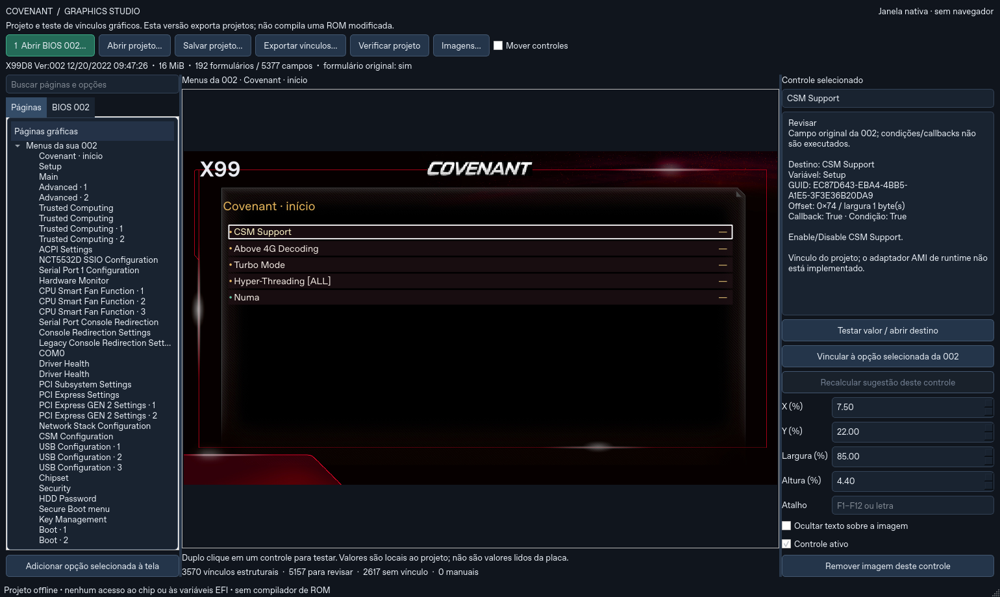

# Covenant Graphics Studio — Windows portátil

**[Baixar Windows x64 — portátil com executável](downloads/Covenant-Graphics-Studio-0.1.1-Windows-x64.zip?raw=true)** · [Baixar fontes](downloads/Covenant-Graphics-Studio-0.1.1-Fontes.zip?raw=true) · [Hashes SHA-256](downloads/SHA256SUMS.txt)

**[Manual completo em português](MANUAL.md)** · [Baixar manual offline e para impressão](downloads/Covenant-Graphics-Studio-0.1.1-Manual.zip?raw=true)

Aplicativo nativo para abrir sua Machinist X99D8 **002**, colocar a camada gráfica Covenant sobre os campos reais e trabalhar nos vínculos. Não usa navegador, WebView ou servidor.

**Esta versão salva e testa um projeto de interface. Não gera uma ROM gráfica, não grava o chip e não altera variáveis EFI. O compilador/adaptador AMI de runtime continua sem implementação.**

## Correção 0.1.1

Corrigida a falha de inicialização `division by zero` do pacote Windows 0.1.0: faltava o plugin JPEG, e a imagem de fundo ficava com largura zero. O pacote agora inclui `qjpeg.dll` da mesma versão do Qt, verifica suas dependências e traz cópias PNG dos 45 recursos JPEG como alternativa de leitura. As imagens originais continuam intactas.

O carregador rejeita imagens nulas antes de calcular a escala e mostra um erro descritivo. Erros inesperados geram `Covenant-Graphics-Studio-erro.txt` na pasta do app ou na pasta temporária. Não há envio automático desse arquivo.

**Baixe a 0.1.1 e extraia em uma pasta nova. Não misture com os arquivos do pacote 0.1.0.** Projetos JSON anteriores continuam compatíveis quando usados com a mesma BIOS.

## Como usar no Windows 10/11 x64

1. Extraia **todo** o ZIP em uma pasta.
2. Abra **Covenant-Graphics-Studio.exe**. Mantenha `runtime`, `assets` e os arquivos do aplicativo junto dele. Não é necessário instalar Python ou executar como administrador.
3. Clique em **Abrir BIOS 002** e selecione sua região BIOS de 8 MiB ou o backup completo de 16 MiB.
4. Em **Menus da sua 002**, o app já cria os controles a partir dos próprios formulários e os associa aos campos originais. Isso mantém, por exemplo, CSM em `Setup/0x74`, sem usar a posição Gigabyte `0x46D`.
5. O grupo **Sugestões a partir da doadora** tenta relacionar os controles por módulo, nome, identidade da variável, tipo e opções. Casos ambíguos ficam sem vínculo; callbacks, condições e campos somente para leitura ficam para revisão.
6. Clique num controle para ver o destino. Para mudar o vínculo, selecione outra opção na aba **BIOS 002** e use **Vincular à opção selecionada**. Listas exigem conferir a tradução de opções; campos numéricos exigem intervalos compatíveis.
7. Dê duplo clique para testar um valor local. A prévia mostra `—` até você escolher um valor de teste; isso não representa a configuração lida da placa. Referências a formulários navegam para as páginas da 002.
8. Use **Mover controles** ou os campos X/Y/largura/altura para editar a posição. Atalhos F1–F12 e letras podem ser atribuídos a controles, sem repetição dentro da página.
9. Em **Imagens**, use as 242 imagens incluídas, escolha uma para o controle/fundo ou substitua por uma edição com as mesmas dimensões. O cabeçalho usa Covenant por padrão. As substituições ficam no projeto, sem reescrever os originais do aplicativo.
10. **Salvar projeto** cria JSON; **Exportar vínculos** cria ZIP com projeto, CSV, manifesto e imagens substitutas. O ZIP exportado não contém BIOS para gravação.

## O que o programa identifica automaticamente

A leitura confere o tamanho, mapa da região BIOS, identificação X99D8 002, layout dos volumes, checksums FV/FFS e microcódigos. Os módulos Setup e Platform são descomprimidos e seus HII/IFR são interpretados. Não se usa um deslocamento fixo do arquivo para adivinhar opções.

São aceitos os varstores do perfil 002 (`Setup` com 125 bytes e `IntelSetup` com 6.091). A variante com logo Covenant e a atualização de microcódigo podem ser analisadas se preservarem esse layout. A 006 e a ROM doadora não são aceitas como base 002.

O grupo de páginas da 002 usa diretamente os identificadores extraídos da BIOS aberta. As sugestões doadoras são conservadoras: sem correspondência única de campo e opções, o programa deixa pendente. Um endereço igual, isoladamente, não é considerado correspondência.

## Significado dos estados

- **Vínculo estrutural:** o destino foi identificado nos dados do projeto; não é uma validação de firmware.
- **Revisar:** há callback, condição ou leitura que não foi executada.
- **Sem vínculo:** não houve correspondência única ou o tipo não é suportado pelo teste.
- **Manual:** o usuário escolheu o destino no projeto; isso também não valida execução na placa.

Projetos pertencem ao SHA-256 da BIOS e à versão dos metadados gráficos usados. O programa recusa um projeto de outro arquivo. Dimensões, destinos, opções, limites numéricos, imagens e atalhos são verificados antes de salvar/exportar.

## Limites

Não é um emulador de hardware nem executa AMITSE, CoolGUIDxe ou callbacks extraídos. A janela desenha uma prévia nativa com os recursos reais, e os testes de valor acontecem somente em memória/projeto. HII fornece campos e metadados, mas não implementa a tradução do código AMI/Gigabyte que falta na adaptação da ROM. As condições de visibilidade IFR não são avaliadas como no firmware.

O app não é um gravador, não exige FPT/flashrom e não inclui backups, NVRAM ou ROMs dos usuários. O JSON/ZIP salvo contém o hash de identificação da BIOS e suas edições de projeto, não o binário original. Não houve teste de boot ou de desempenho.

## Código-fonte e testes

O pacote inclui o código-fonte Python/C. Para desenvolvimento:

```bash
python -m pip install -r requirements.txt
python covenant_graphics_studio.py
```

Os testes usam Python/Qt. A variável `COVENANT_BIOS_FIXTURE` pode apontar para um backup privado completo de 16 MiB; ele não é distribuído. O leitor foi conferido com a 002 real e os fluxos da interface foram exercitados no Qt/Linux. O launcher PE x64 para Windows foi compilado e sua composição verificada; a execução nativa no Windows ainda precisa ser conferida nesse sistema.

Os recursos gráficos foram extraídos da ROM enviada pelo usuário com identificação `X99D4JWAGNER`, e a faixa foi substituída pela arte Covenant preparada nesta conversa. O interpretador HII deriva do trabalho anterior no repositório Machinist-E5-D8-Max. Python e Qt possuem licenças próprias, incluídas em `licenses` no pacote portátil.

## Janela do aplicativo



[Resultados de verificação](docs/validation.json). Os downloads acima são idênticos aos pacotes entregues na conversa.
